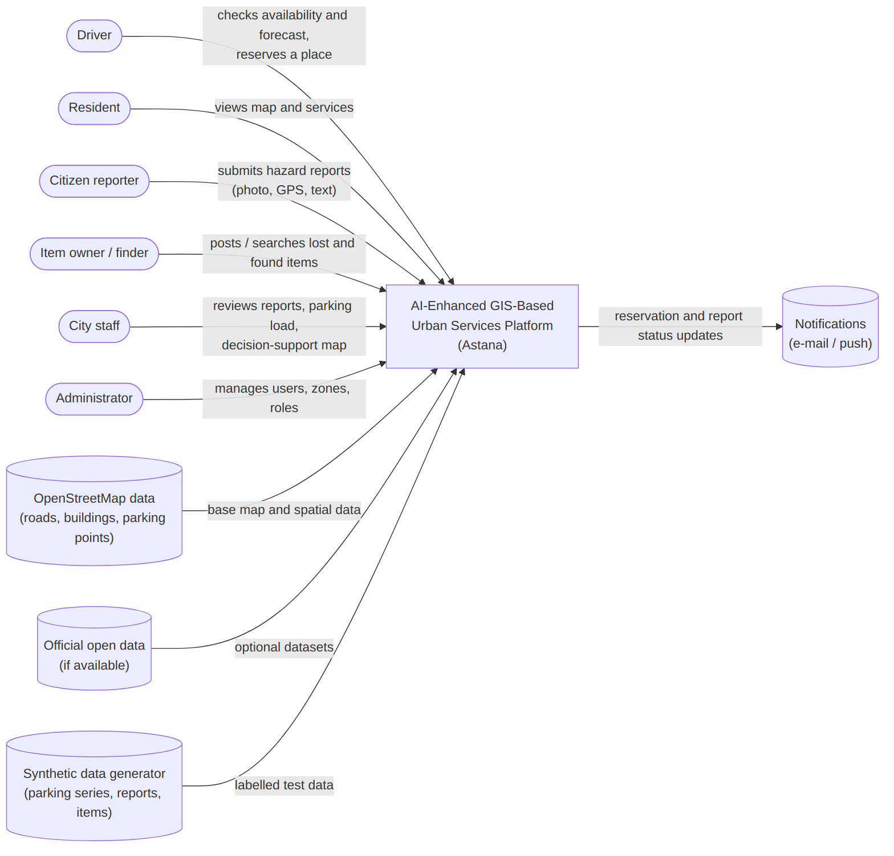
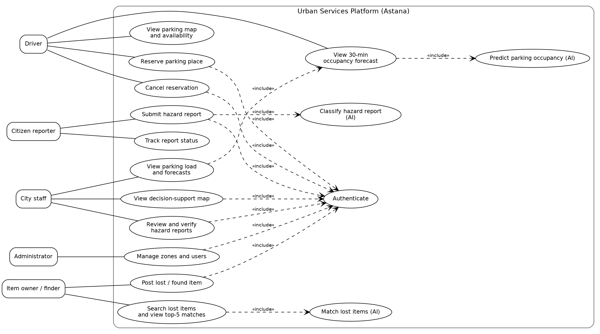
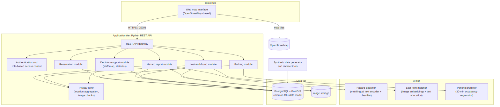

# 7. Architecture and Diagrams

Editable sources are in `diagrams/src/` (Mermaid `.mmd`, Graphviz `.dot`); images in `diagrams/png/`. GitHub/GitLab render `.mmd` directly; the online editor is https://mermaid.live. Regenerate:
```
mmdc -i diagrams/src/01-system-context.mmd -o diagrams/png/01-system-context.png -b white -s 2
dot -Tpng -Gdpi=150 diagrams/src/02-use-cases.dot -o diagrams/png/02-use-cases.png
```

## 1. Architectural description
A web platform with a **common GIS data model**, a Python REST API, three AI modules and a web map interface (all based on the Midterm Research Proposal).

| Tier | Responsibility | Elements |
|---|---|---|
| Client | Map, forms, staff dashboard | Web map interface on OpenStreetMap |
| Application | Business logic, access control, privacy, API | REST API with Parking, Reservation, Hazard, Lost-and-found and Decision-support modules; Authentication/RBAC; Privacy layer |
| AI | Intelligent functions | Hazard classifier (multilingual text encoder + classifier); Lost-item matcher (image embeddings + text + location); Parking predictor (30-min regression) |
| Data | Persistence | PostgreSQL + PostGIS; image storage; synthetic data generator |

**Key design decisions**
1. **One spatial data model for all four functions** — answers the research gap; all entities carry status and verification fields (Objective 2).
2. **AI modules sit behind the API**, are replaceable and can be evaluated offline against baselines.
3. **Human verification** — AI suggests, staff/users confirm (explainability, trust [13], [14]).
4. **Privacy by design** — role-based access, aggregated location data, no faces/number plates, no public contact data [15].
5. **Reservation integrity** — capacity checks inside a database transaction.
6. **Synthetic data are labelled** in the data model (`data_source`).

## 2. Diagrams
### 2.1 System context diagram

Source: `diagrams/src/01-system-context.mmd`

### 2.2 Use case diagram

Source: `diagrams/src/02-use-cases.dot`

### 2.3 Component diagram (draft)

Source: `diagrams/src/03-component-draft.mmd` — draft; interfaces will be refined in implementation.

### 2.4 Supporting diagrams
**Common data model (ER)** — `diagrams/src/04-data-model.mmd`


**Hazard report flow** — `diagrams/src/05-hazard-report-sequence.mmd`


**Parking reservation flow** — `diagrams/src/06-reservation-sequence.mmd`


## 3. Consistency: requirements ↔ use cases ↔ components ↔ data
| Use case | Requirements | Components | Data |
|---|---|---|---|
| View parking map and availability | FR-P1, FR-P3 | UI, Parking module | PARKING_ZONE, OCCUPANCY_OBSERVATION |
| View 30-min forecast | FR-P2, FR-P4 | Parking module, Parking predictor | OCCUPANCY_FORECAST |
| Reserve / cancel parking | FR-R1–R4 | Reservation module | RESERVATION |
| Submit hazard report | FR-H1, FR-H2, FR-H3, FR-H7 | Hazard module, Privacy layer, Hazard classifier | HAZARD_REPORT |
| Track report status | FR-H5 | Hazard module | HAZARD_REPORT |
| Review and verify reports | FR-H4, FR-H6 | Hazard module, Authentication | HAZARD_REPORT, REPORT_REVIEW |
| Post lost/found item | FR-L1, FR-L5 | Lost-and-found module, Privacy layer | LOST_FOUND_ITEM |
| Search / top-5 matches | FR-L2–L4 | Lost-and-found module, Item matcher | ITEM_MATCH |
| Decision-support map | FR-S1–S4 | Decision-support module, Privacy layer | all entities (aggregated) |
| Manage zones and users | FR-C3 | Authentication, Parking module | USER, PARKING_ZONE |
| Authenticate | FR-C1 | Authentication/RBAC | USER |

## 4. Draft REST API
| Method and path | Purpose | Role |
|---|---|---|
| `GET /api/parking/zones` | Zones with free places, forecast, data source | public |
| `POST /api/reservations`, `DELETE /api/reservations/{id}` | Reserve, cancel | driver |
| `POST /api/hazard-reports` | Submit report; returns suggested category | registered user |
| `GET /api/hazard-reports/mine` | Own reports with status | registered user |
| `GET /api/staff/reports`, `PATCH /api/staff/reports/{id}` | Staff review and verification | staff |
| `POST /api/items`, `GET /api/items/{id}/matches` | Post item, top-5 matches | registered user |
| `GET /api/staff/map` | Aggregated layers and statistics | staff |
| `POST /api/auth/login`, `/register` | Authentication | public |

## 5. Quality attributes and tactics
| Attribute | Tactic |
|---|---|
| Accuracy/explainability | Baselines, confidence values, human verification |
| Privacy/security | RBAC, aggregation, photo checks, hashed passwords |
| Performance | Spatial indexes (GiST), lightweight models, paging |
| Reliability | AI modules fail independently of core services |
| Testability | AI modules and data generator behind interfaces; seeded data |

## 6. Known limitations of the draft
- Authentication details, notification channel and deployment diagram are not designed yet (planned: Docker Compose with `web`, `api`, `db`).
- The data model has no user-profile or audit tables beyond what is needed for the evaluation.
